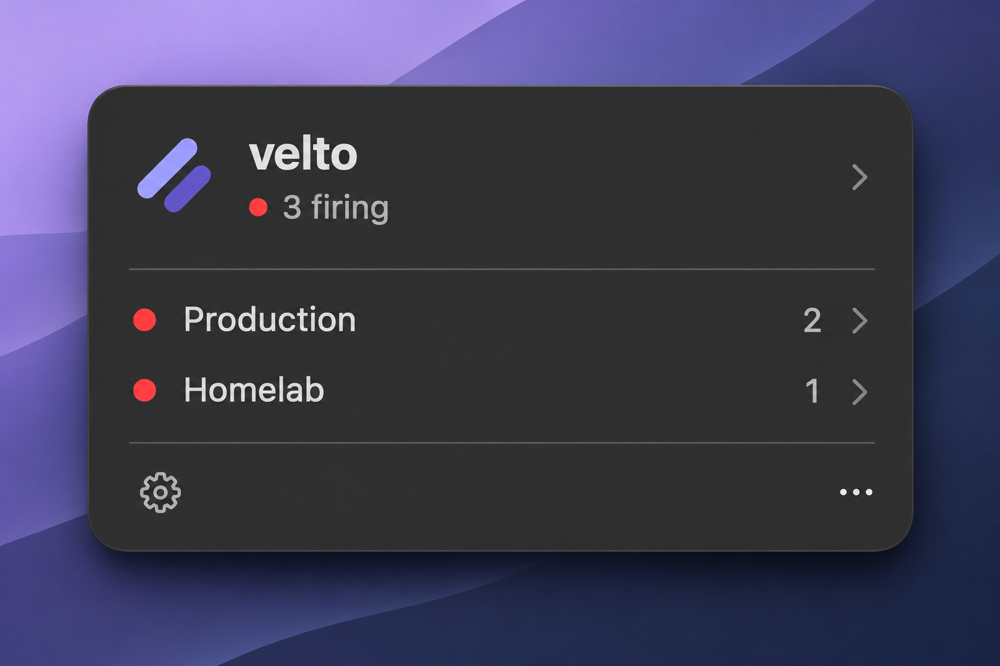
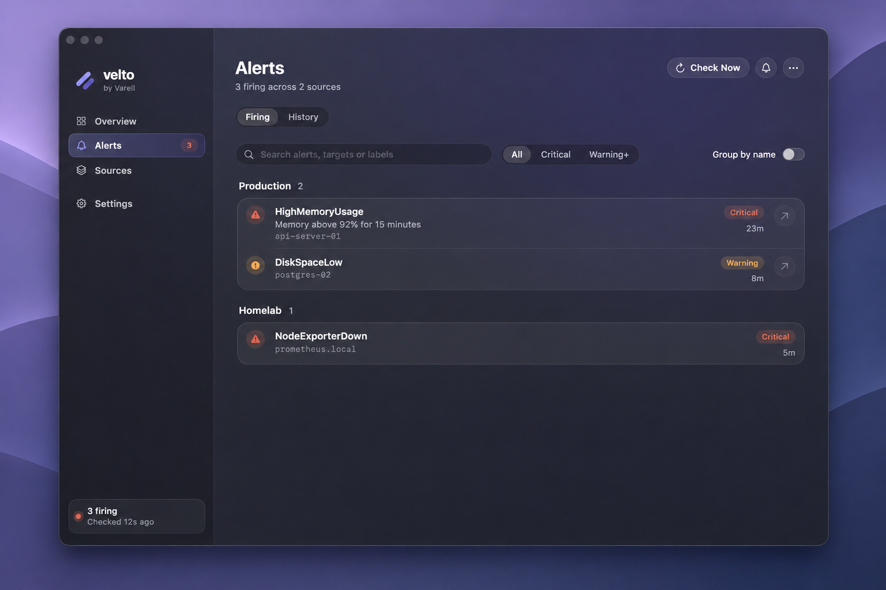
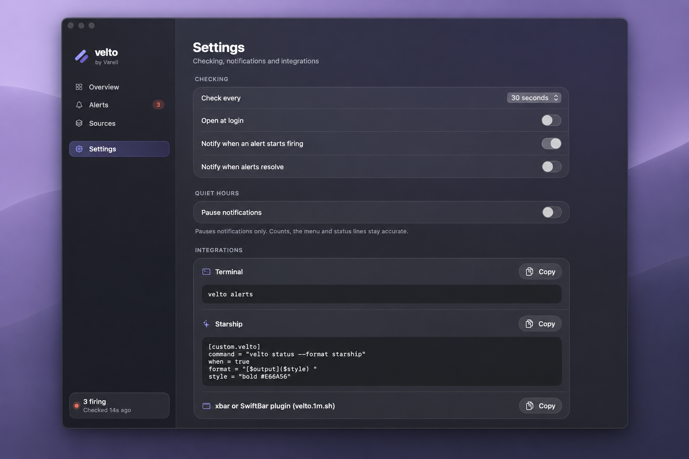

<p align="center">
  <picture>
    <source media="(prefers-color-scheme: dark)" srcset="Branding/velto-primary-dark.svg">
    
  </picture>
</p>

<h1 align="center">Your infrastructure, at a glance.</h1>

<p align="center">Prometheus, Grafana and Alertmanager alerts in your macOS menu bar.<br>See what’s firing without switching to a dashboard.</p>

<p align="center">
  <a href="https://github.com/Varell-co/Velto/releases"><b>Download for Mac ↗</b></a> &nbsp; · &nbsp;
  <a href="docs/USAGE.md">Getting started</a> &nbsp; · &nbsp;
  <a href="docs/DEVELOPMENT.md">Build from source</a>
</p>

<p align="center"><sub>macOS 13+ deployment target &nbsp; · &nbsp; Menu bar and CLI &nbsp; · &nbsp; Pre-release</sub></p>



### Know what needs attention

See how many alerts are firing across your sources. Velto can notify you when an alert starts firing and marks cached results when a source is unreachable.



**Find the alert you need.** Search by alert name, target or label, filter by severity, and group alerts that share a name. Open the linked runbook or dashboard when the alert supplies one.

**Control what interrupts you.** Snooze an alert locally or silence it upstream on Alertmanager and Grafana Alerting. Quiet hours pause notifications while counts stay current.



**Keep status in your workflow.** Run `velto alerts` in your terminal or add a status line to Starship, xbar or SwiftBar. They read Velto’s local cache without polling your servers.

**Watch your own metrics.** Pin a PromQL query to a Prometheus or Grafana Mimir source and set thresholds for the values you care about. Add direct probes for services outside your monitoring stack.

### Get Velto

The first GitHub release will provide a universal Mac ZIP and enable the [Homebrew](https://brew.sh) cask. Once it’s published, install the app and CLI together with:

```sh
brew tap varell-co/velto https://github.com/Varell-co/Velto
brew trust --cask varell-co/velto/velto
brew install --cask varell-co/velto/velto
```

Update with `brew upgrade --cask varell-co/velto/velto`, or download the ZIP from [Releases](https://github.com/Varell-co/Velto/releases), extract it, and open `Velto.app`. Open **Sources** and choose **Add Source** to connect your first endpoint. You can [build from source](docs/DEVELOPMENT.md) today.

> [!IMPORTANT]
> **Unnotarized builds.** Velto uses an ad-hoc signature, so Gatekeeper may block the ZIP download. Open it only if you trust the source. See [Apple’s instructions for opening an unnotarized app](https://support.apple.com/en-us/102445).

Velto polls the endpoints you configure, caches alert data on your Mac, and stores source tokens and passwords in macOS Keychain. See the [supported endpoints and authentication options](docs/USAGE.md#sources).

<p align="center">
  <a href="docs/USAGE.md">Usage &amp; troubleshooting</a> &nbsp; · &nbsp;
  <a href="docs/DEVELOPMENT.md">Development</a> &nbsp; · &nbsp;
  <a href="LICENSE">MIT license</a>
</p>

<p align="center"><sub>A <a href="https://varell.co">Varell</a> product.</sub></p>
